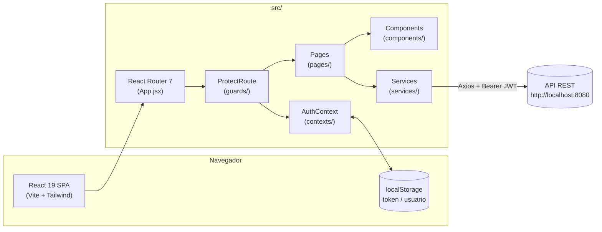

# Blessed7 — Frontend

**Plataforma web de gestão para clínicas de estética** — agendamento de procedimentos, gestão de clientes, controle de estoque e dashboard analítico com indicadores de negócio.

`React 19` · `Vite 8` · `React Router 7` · `Tailwind CSS 4` · `Axios` · `Chart.js` · `JWT`

---

## Sumário

1. [Visão geral](#1-visão-geral)
2. [Arquitetura da aplicação](#2-arquitetura-da-aplicação)
3. [Stack tecnológica](#3-stack-tecnológica)
4. [Estrutura de pastas](#4-estrutura-de-pastas)
5. [Perfis de acesso e autenticação](#5-perfis-de-acesso-e-autenticação)
6. [Mapa de rotas](#6-mapa-de-rotas)
7. [Módulos funcionais](#7-módulos-funcionais)
8. [Camada de serviços (integração com API)](#8-camada-de-serviços-integração-com-api)
9. [Catálogo de componentes](#9-catálogo-de-componentes)
10. [Utilitários (`utils/`)](#10-utilitários-utils)
11. [Design system e identidade visual](#11-design-system-e-identidade-visual)
12. [Instalação e execução local](#12-instalação-e-execução-local)
13. [Scripts disponíveis](#13-scripts-disponíveis)
14. [Convenções de código](#14-convenções-de-código)

---

## 1. Visão geral

O **Blessed7** é o sistema de gestão da clínica estética de mesmo nome. A aplicação atende três perfis de usuário distintos dentro de uma única SPA (Single Page Application):

| Perfil | Papel no sistema |
|---|---|
| **Cliente** | Visitante que se cadastra, agenda procedimentos estéticos e acompanha/avalia consultas realizadas. |
| **Funcionário** | Colaborador da clínica com acesso operacional: gestão de clientes, agendamentos e estoque. |
| **Gestor** | Administrador com acesso total, incluindo gestão de funcionários e dashboard executivo. |

O projeto cobre três frentes de negócio simultaneamente:

- **Site institucional** — páginas públicas (home, sobre, procedimentos, depoimentos, trabalhe conosco, termos e privacidade) que apresentam a marca e convertem visitantes em agendamentos.
- **Portal do cliente** — fluxo de agendamento (wizard em etapas) e histórico de consultas com avaliação de atendimento.
- **Painel administrativo (back-office)** — dashboard com KPIs e gráficos, CRUD de clientes, funcionários, estoque de produtos e gestão centralizada de agendamentos.

---

## 2. Arquitetura da aplicação

A aplicação segue uma arquitetura **SPA client-side** consumindo uma API REST externa. O estado é resolvido localmente por página via `useState`/`useEffect`, com um Contexto global dedicado à autenticação.



**Fluxo de autenticação:**

1. O usuário faz login em `PaginaDeLogin` → `authService.login()` envia `POST /usuarios/login`.
2. O backend retorna um **JWT**, decodificado no frontend com `jwt-decode` para extrair `email` (`sub`), `id` e `role`.
3. Token, nome e role são persistidos em `localStorage` e injetados no `AuthContext`.
4. Toda requisição subsequente (via `services/api.js`) anexa o header `Authorization: Bearer <token>` automaticamente através de um interceptor Axios.
5. O `ProtectRoute` (route guard) verifica a presença do token e se a `role` do usuário está na lista `rolesPermitidas` da rota antes de renderizar o `Outlet`; caso contrário, redireciona com feedback via `sonner` (toast).

---

## 3. Stack tecnológica

| Categoria | Tecnologia | Versão | Finalidade |
|---|---|---|---|
| Core | [React](https://react.dev) | `^19.2.4` | Biblioteca de UI (componentes funcionais + hooks) |
| Build tool | [Vite](https://vite.dev) | `^8.0.4` | Dev server com HMR e bundler de produção |
| Roteamento | [React Router DOM](https://reactrouter.com) | `^7.14.0` | Roteamento client-side e proteção de rotas |
| Estilização | [Tailwind CSS](https://tailwindcss.com) | `^4.2.2` | Utility-first CSS, integrado via plugin nativo do Vite |
| HTTP client | [Axios](https://axios-http.com) | `^1.15.2` | Requisições HTTP e interceptors de autenticação |
| Autenticação | [jwt-decode](https://github.com/auth0/jwt-decode) | `^4.0.0` | Decodificação de payload JWT no cliente |
| Gráficos | [Chart.js](https://www.chartjs.org) + [react-chartjs-2](https://react-chartjs-2.js.org) | `^4.5.1` / `^5.3.1` | Visualização de dados no dashboard |
| Notificações | [Sonner](https://sonner.emilkowal.ski) | `^2.0.8` | Sistema de toasts (feedback de UI) |
| Exportação de dados | [SheetJS (xlsx)](https://sheetjs.com) | `^0.18.5` | Geração de relatórios `.xlsx` no navegador |
| Qualidade | ESLint 9 (flat config) + `eslint-plugin-react-hooks` + `eslint-plugin-react-refresh` | `^9.39.4` | Padronização e prevenção de erros de hooks |

---

## 4. Estrutura de pastas

```
blsd-frontend-development/
├── public/
│   ├── favicon.svg
│   └── icons.svg
├── src/
│   ├── assets/                  # Imagens dos procedimentos e mídia institucional
│   ├── components/               # Componentes de UI reutilizáveis (ver seção 9)
│   ├── contexts/
│   │   └── AuthContext.jsx       # Estado global de autenticação (usuário, login, logout, RBAC)
│   ├── guards/
│   │   └── ProtectRoute.jsx      # Guard de rota baseado em token + role
│   ├── hooks/
│   │   └── useAgendamento.js     # Hook de submissão de agendamento
│   ├── pages/                    # Páginas / telas da aplicação (ver seção 7)
│   ├── services/                 # Módulos de acesso à API REST (ver seção 8)
│   ├── utils/                    # Formatadores, máscaras e validadores
│   ├── App.jsx                   # Definição de rotas e proteção por role
│   ├── App.css
│   ├── index.css                 # Import do Tailwind + estilos globais
│   └── main.jsx                  # Bootstrap da aplicação (Providers + render)
├── index.html
├── vite.config.js                # Plugins: @vitejs/plugin-react + @tailwindcss/vite
├── eslint.config.js              # Flat config do ESLint 9
├── package.json
└── README.md
```

---

## 5. Perfis de acesso e autenticação

O controle de acesso (RBAC) é modelado por três `roles`, refletidas na claim `role` do JWT e mapeadas para IDs de perfil no backend (`acesso.id`):

| Role | ID (`acesso.id`) | Descrição |
|---|:---:|---|
| `CLIENTE` | `3` | Perfil padrão de quem se cadastra publicamente. Acesso ao fluxo de agendamento. |
| `FUNCIONARIO` | `2` | Colaborador. Acesso ao back-office operacional. |
| `GESTOR` | — | Nível mais alto. Acesso irrestrito, incluindo o módulo de Funcionários. |

**`AuthContext` (`src/contexts/AuthContext.jsx`)** expõe:

| Membro | Tipo | Descrição |
|---|---|---|
| `usuario` | `object \| null` | Objeto do usuário logado (`nome`, `email`, `id`, `acesso.nome`), reidratado do `localStorage` na inicialização. |
| `salvarUsuario(dados)` | `função` | Persiste token/usuário após login bem-sucedido e decodifica o JWT. |
| `logout()` | `função` | Limpa `localStorage` e estado do contexto. |
| `temPermissao(rolesPermitidas)` | `função` | Verifica se a role atual está contida em uma lista (ou é igual a uma string) de roles permitidas — usada por menus e componentes condicionais. |

**`ProtectRoute` (`src/guards/ProtectRoute.jsx`)** é um *layout route* do React Router: envolve grupos de rotas com `<Route element={<ProtectRoute rolesPermitidas={[...]}/>}>` e renderiza `<Outlet/>` somente se o token existir e a role estiver autorizada; caso contrário, dispara um toast informativo e redireciona (`/login` ou `/`).

---

## 6. Mapa de rotas

Definidas em `src/App.jsx`:

| Rota | Página | Acesso | Observação |
|---|---|:---:|---|
| `/` | `PaginaInicial` | Público | Landing page institucional |
| `/cadastro` | `PaginaDeCadastro` | Público | Cadastro de novo cliente |
| `/login` | `PaginaDeLogin` | Público | Autenticação |
| `/dashboard` | `PaginaDashboard` | `FUNCIONARIO`, `GESTOR` | KPIs e gráficos executivos |
| `/clientes` | `PaginaClientes` | `FUNCIONARIO`, `GESTOR` | CRUD de clientes |
| `/estoque` | `PaginaEstoque` | `FUNCIONARIO`, `GESTOR` | Controle de inventário |
| `/agendamentos` | `PaginaGerenciarAgendamentos` | `FUNCIONARIO`, `GESTOR` | Gestão centralizada de consultas |
| `/funcionarios` | `PaginaFuncionarios` | `GESTOR` (aninhada dentro do grupo acima) | CRUD de colaboradores |
| `/agendar` | `PaginaAgendamento` | `CLIENTE` | Wizard de agendamento de procedimento |
| `/privacidade` | `PaginaPrivacidade` | Público | Política de privacidade |
| `/termos` | `PaginaTermos` | Público | Termos de uso |
| `/trabalhe-conosco` | `PaginaTrabalheConosco` | Público | Formulário de candidatura a vaga |
| `*` | `PaginaNaoEncontrado` | Público | 404 |

Um componente utilitário `ScrollToTop` (definido inline em `App.jsx`) garante rolagem suave ao topo a cada troca de rota.

---

## 7. Módulos funcionais

### 7.1 Site institucional (público)

Composto por seções reutilizáveis renderizadas na `PaginaInicial`: `SecaoPrincipal` (hero), `SecaoDestaque`, `SecaoProcedimentos`, `SobreNos`, `SecaoDepoimentos` e `SecaoCTA`, encapsuladas por um shell público (`ShellPublico`) com `BarraDeNavegacao` e `Rodape` compartilhados.

### 7.2 Autenticação e onboarding

`PaginaDeLogin` e `PaginaDeCadastro` utilizam `CartaoDeLogin`/`CartaoDeCadastro` como formulários encapsulados, validados por `utils/validators.js` (e-mail, senha forte, CPF) e mascarados por `utils/formatters.js`.

### 7.3 Agendamento (fluxo do cliente)

`PaginaAgendamento` implementa um **wizard multi-etapas** guiado por `IndicadorDePassos`:

1. **Escolha do procedimento** — catálogo de serviços estéticos (`CartaoProcedimento`), com categorias *Facial* e *Corporal*, imagens, preço e dicas pré-procedimento (`CartaoDicasPreProcedimento`).
2. **Escolha de local, data e horário** — `SeletorDeLocal`, `CalendarioAgendamento` (calendário mensal navegável) e `SeletorDeHorario`.
3. **Confirmação** — `CartaoConfirmacaoAgendamento` resume a escolha; a submissão é feita via `useAgendamento` (hook que chama `agendamentoService.criarAgendamento`, integrado a um provedor externo de agenda — `POST /api/calendario/calcom/agendar`, sugerindo integração com **Cal.com**).
4. **Tela de sucesso** — `TelaConfirmacaoAgendamento`.

A navegação entre etapas é controlada por `BarraAcaoAgendamento` e `RodapeAgendamento`. Clientes autenticados também podem consultar e **avaliar** consultas já realizadas via `BalaoAgendamentos` (popover flutuante renderizado com `createPortal`), que consome `consultaService`.

### 7.4 Dashboard executivo (`/dashboard`)

Tela orientada a indicadores para `FUNCIONARIO`/`GESTOR`:

- **KPIs em cartões** (`CartaoKPI`): faturamento mensal, procedimentos realizados no mês, receita anual total e ticket médio — carregados em paralelo com `Promise.allSettled` para que a falha de um endpoint não derrube o painel inteiro (skeleton de loading exibido durante o carregamento).
- **Gráfico de tendência de faturamento** (`GraficoTendenciaFaturamento`, Chart.js) e **ranking de procedimentos realizados** (`CartaoProcedimentosRealizados`).
- **Tabela de próximos agendamentos** (`TabelaProximosAgendamentos`).
- **Exportação de relatório executivo em Excel**: a função `exportarRelatorio()` monta, em tempo real no navegador, uma planilha `.xlsx` (via SheetJS) com resumo de performance, detalhamento de receita por serviço e distribuição por meio de pagamento, incluindo formatação de moeda (`R$ #,##0.00`) e percentuais nas células.

### 7.5 Gestão de clientes (`/clientes`)

`PaginaClientes` + `TabelaClientes` (com paginação via `Paginacao`) + `CartaoKPIClientes`: listagem paginada e busca de clientes, edição de dados/foto (upload `multipart/form-data`) via `ModalEditarPerfil`, e exclusão.

### 7.6 Gestão de estoque (`/estoque`)

`PaginaEstoque` + `TabelaInventario` + `CartaoKPIEstoque` + `CartaoUltimasMovimentacoes`: CRUD de produtos (`produtoService`) e registro de entradas/saídas de estoque (`movimentacaoService`), com exportação e filtros.

### 7.7 Gestão de agendamentos (`/agendamentos`)

`PaginaGerenciarAgendamentos` centraliza a visão de todas as consultas da clínica (não apenas do cliente logado), com `BarraFiltrosAgendamento` (filtro por paciente, período, procedimento e status), `ModalDetalhesAgendamento` para inspeção detalhada e `gerencAgendamentoService` para consultas paginadas/agregadas por cliente.

### 7.8 Gestão de funcionários (`/funcionarios`)

Exclusiva para `GESTOR`. CRUD completo de colaboradores via `funcionarioService`, incluindo cadastro, edição, remoção e upload de foto de perfil.

### 7.9 Páginas institucionais adicionais

`PaginaPrivacidade`, `PaginaTermos` e `PaginaTrabalheConosco` (formulário de candidatura a vaga) completam o conjunto de páginas públicas de compliance e RH.

---

## 8. Camada de serviços (integração com API)

A API é consumida via `axios`. A instância compartilhada `services/api.js` possui um *interceptor* que injeta automaticamente o `Authorization: Bearer <token>` em toda requisição.

| Serviço | Recurso da API | Principais funções |
|---|---|---|
| `authService.js` | `/usuarios/login`, `/cliente` | `login()`, `cadastrar()` |
| `clienteService.js` | `/cliente` | `listarClientes()` (paginado), `listarCliente()`, `atualizarCliente()`, `deletarCliente()`, `atualizarFotoCliente()` |
| `funcionarioService.js` | `/funcionario` | `listarFuncionarios()`, `buscarFuncionarioPorId()`, `cadastrarFuncionario()`, `atualizarFuncionario()`, `deletarFuncionario()`, `atualizarFotoFuncionario()` |
| `produtoService.js` | `/produto` | `listarProdutos()` (paginado), `criarProduto()`, `atualizarProduto()`, `deletarProduto()` |
| `movimentacaoService.js` | `/movimentacao` | `listarMovimentacoes()`, `registrarMovimentacao()` |
| `agendamentoService.js` | `/api/calendario/calcom/agendar` | `criarAgendamento()` — converte data/hora local para ISO 8601 (UTC-3 → UTC) |
| `consultaService.js` | `/consulta` | `listarConsultasCliente()`, `avaliarConsulta()` |
| `gerencAgendamentoService.js` | `/consulta` | `listarConsultas()` (paginado, com filtros), `listarConsultasPorCliente()`, `listarTodasConsultas()` (agregação em lote via `Promise.all`) |
| `avaliacaoService.js` | `/avaliacao` | `listarAvaliacoes()`, `listarAvaliacaoPorId()`, `deletarAvaliacao()` |
| `dashboardService.js` | `/dashboard/*` | `getFaturamentoMensal()`, `getProcedimentosMensal()`, `getReceitaAnualTotal()`, `getTicketMedio()`, `getTendenciaFaturamento()`, `getReceitaPorAno()`, `getRankingServicos()`, `getProximosAgendamentos()` |

Os serviços paginados (`clienteService`, `produtoService`, `gerencAgendamentoService`) implementam uma função `normalizarPagina()` que aceita tanto uma resposta em array simples quanto o formato `Page` do Spring Data (`content`, `totalElements`, `totalPages`, `number`, `size`), garantindo compatibilidade com variações no contrato do backend.

---

## 9. Catálogo de componentes

Os componentes em `src/components/` podem ser agrupados por responsabilidade:

| Grupo | Componentes |
|---|---|
| **Layout / navegação** | `LayoutPrincipal`, `BarraDeNavegacaoLateral` (menu do back-office, sensível a `role`), `BarraDeNavegacaoSuperior`, `BarraDeNavegacao`, `CabecalhoGlobal`, `CabecalhoPagina`, `Breadcrumbs`, `Rodape`, `ShellPublico` |
| **Institucional (landing page)** | `SecaoPrincipal`, `SecaoDestaque`, `SecaoProcedimentos`, `SobreNos`, `SecaoDepoimentos`, `SecaoCTA` |
| **Autenticação** | `CartaoDeLogin`, `CartaoDeCadastro` |
| **Agendamento (wizard)** | `IndicadorDePassos`, `CartaoProcedimento`, `SeletorDeData`, `SeletorDeHorario`, `SeletorDeLocal`, `CalendarioAgendamento`, `CartaoConfirmacaoAgendamento`, `CartaoDicasPreProcedimento`, `BarraAcaoAgendamento`, `RodapeAgendamento`, `TelaConfirmacaoAgendamento`, `BalaoAgendamentos` (popover de histórico/avaliação) |
| **Dashboard / indicadores** | `CartaoKPI`, `CartaoKPIClientes`, `CartaoKPIEstoque`, `CartaoVisaoGeral`, `CartaoAlertaInteligente`, `CartaoRelatorioDetalhado`, `GraficoReceitaAnual`, `GraficoTendenciaFaturamento`, `CartaoProcedimentosRealizados` |
| **Tabelas e listagens** | `TabelaClientes`, `TabelaInventario`, `TabelaProximosAgendamentos`, `CartaoListaAgendamentos`, `CartaoUltimasMovimentacoes`, `Paginacao` |
| **Agendamentos (gestão interna)** | `BarraFiltrosAgendamento`, `ModalDetalhesAgendamento` |
| **Perfil** | `ModalEditarPerfil` |

Convenção observada: componentes de UI usam ícones SVG inline (sem biblioteca de ícones externa), estilizados exclusivamente com classes utilitárias Tailwind e uma paleta de marca consistente (`#2C3E2D` verde-oliva escuro, `#f5f4ec`/`#f9f8f2` bege claro).

---

## 10. Utilitários (`utils/`)

| Arquivo | Função | Descrição |
|---|---|---|
| `formatters.js` | `formatarCpf()`, `formatarTelefone()` | Máscaras de exibição (`000.000.000-00`, `(00) 00000-0000`) |
| `masks.js` | `removerMascara()` | Remove caracteres não numéricos antes do envio à API |
| `validators.js` | `validarEmail()`, `validarSenha()`, `validarCpf()` | `validarSenha` exige 8+ caracteres, maiúscula, minúscula, número e símbolo; `validarCpf` implementa o algoritmo oficial de dígitos verificadores |
| `dateUtils.js` | — | Reservado para lógica de datas do domínio |

---

## 11. Design system e identidade visual

A aplicação mantém consistência visual através de convenções repetidas entre componentes:

- **Paleta:** verde-oliva escuro `#2C3E2D` (marca/ação primária), verde-claro `#a8c5a0` (destaque secundário sobre fundo escuro), bege `#f5f4ec`/`#f9f8f2` (fundo de aplicação) e `#e8e6d9` (bordas).
- **Tipografia:** hierarquia via utilitários Tailwind (`font-black`, `font-bold`, `font-semibold`) com títulos grandes e textos auxiliares em `text-[9px]`–`text-xs` uppercase com `tracking-widest`, remetendo a um estilo *editorial/clínico premium*.
- **Componentização de ícones:** todos os ícones são SVGs `stroke="currentColor"` definidos inline, permitindo controle fino de peso de traço por contexto.
- **Feedback ao usuário:** padronizado via `sonner` (`toast.info`, `richColors`), configurado globalmente em `main.jsx`.

---

## 12. Instalação e execução local

### Pré-requisitos

- **Node.js** 18+ (recomendado 20 LTS)
- **npm** (o repositório versiona `package-lock.json`)
- Uma instância do **backend Blessed7** rodando em `http://localhost:8080`

### Passo a passo

```bash
# 1. Clonar o repositório
git clone https://github.com/Core-System/blsd-frontend-development.git
cd blsd-frontend-development

# 2. Instalar dependências
npm install

# 3. Subir o servidor de desenvolvimento (Vite)
npm run dev
```

A aplicação estará disponível em `http://localhost:5173` (porta padrão do Vite), com Hot Module Replacement ativo.

---

## 13. Scripts disponíveis

| Comando | Ação |
|---|---|
| `npm run dev` | Inicia o servidor de desenvolvimento Vite com HMR |
| `npm run build` | Gera o build de produção otimizado em `dist/` |
| `npm run preview` | Serve localmente o build de produção para verificação |
| `npm run lint` | Executa o ESLint sobre todo o projeto (`eslint .`) |

---

## 14. Convenções de código

- **Idioma do domínio:** todo o código — componentes, variáveis, funções e comentários — é escrito em **português (pt-BR)**, refletindo a linguagem ubíqua do negócio (clínica de estética brasileira).
- **Componentes funcionais + Hooks:** todo o código usa componentes de função e hooks nativos do React.
- **ESLint (flat config, ESLint 9):** configurado com `js.configs.recommended`, `eslint-plugin-react-hooks` (regras de hooks) e `eslint-plugin-react-refresh` (compatibilidade com Fast Refresh do Vite).
- **Tailwind CSS 4** via plugin oficial do Vite (`@tailwindcss/vite`), com configuração CSS-first do Tailwind v4.
- **Padrão de resiliência de API:** uso de `Promise.allSettled` (dashboard) e normalização de payloads paginados (`normalizarPagina`), reduzindo o acoplamento ao formato exato da resposta do backend.
